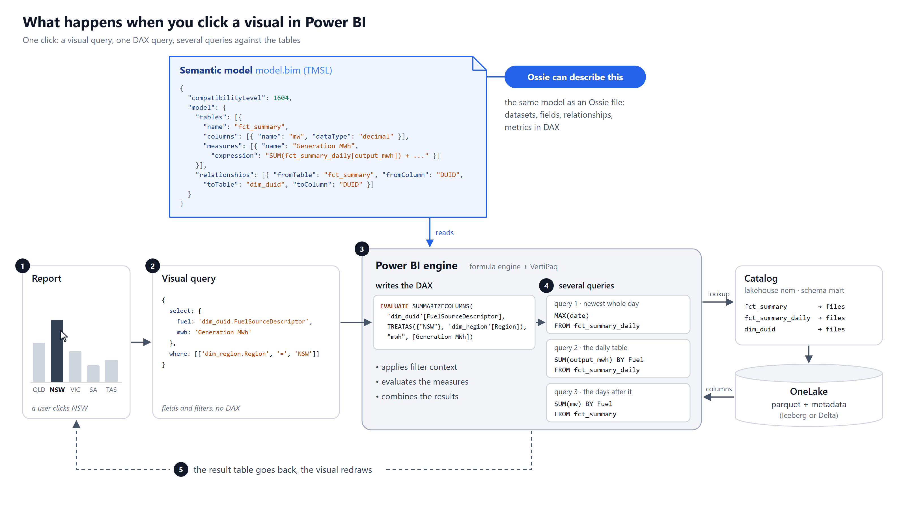

# First look at Apache Ossie

*Draft, October 2026*



| Stack | Visual query | Engine | Model | Storage |
|---|---|---|---|---|
| Power BI | fields + filters | formula engine + VertiPaq, which writes the DAX | `model.bim` / TMDL | Import, DirectQuery, Direct Lake |
| Snowflake | `SEMANTIC_VIEW()` / `AGG()` in SQL | Snowflake | semantic view | Snowflake tables |
| Databricks | `MEASURE()` in SQL | Databricks SQL | metric view (Unity Catalog) | Delta tables |
| This project | query object, written as DAX | dax-sql on DuckDB-WASM | `ossie.yaml` | Iceberg on OneLake |

Ossie is a common file format for the **Model** column.

## What Ossie is

**A specification for describing a semantic model in YAML.** The project calls it an "industry
wide specification effort to standardize how we exchange semantic metadata across analytics,
AI and BI platforms" ([apache/ossie](https://github.com/apache/ossie)).

A short history:

- **September 2025.** Snowflake announces the *Open Semantic Interchange* (OSI), co-led with
  Salesforce (Tableau), dbt Labs, BlackRock and RelationalAI. Launch partners include Cube,
  Hex, Sigma, ThoughtSpot, Alation, Atlan and others
  ([press release](https://www.businesswire.com/news/home/20250923902448/en/)).
- **Spring 2026.** Databricks joins
  ([Databricks blog](https://www.databricks.com/blog/redefining-semantics-data-layer-future-bi-and-ai)).
- **Mid 2026.** OSI enters the Apache Incubator. It is renamed **Ossie** to avoid a clash with
  other projects called OSI, and the YAML format stays the same
  ([announcement](https://ossie.apache.org/updates/ossie-enters-apache-incubator/)).
- **October 2026.** Microsoft and Google publicly back it
  ([InfoWorld](https://www.infoworld.com/article/4229785/microsoft-google-back-apache-ossie-to-make-enterprise-data-and-ai-platforms-more-interoperable-2.html)).
  Microsoft engineers wrote the Power BI converter and added DAX as a dialect
  ([Snowflake blog](https://www.snowflake.com/en/blog/engineering/apache-ossie-microsoft-ecosystem-support/)).

The current core spec is **0.2.0.dev0**, and the spec marks it as a draft: "Schema is mutable;
do not depend on this version in production"
([spec.md](https://github.com/apache/ossie/blob/main/core-spec/spec.md)).

### What a model holds

One file holds one model:

- **datasets**: the tables, each with a source, a primary key and fields.
- **fields**: the columns, each an expression with a data type.
- **relationships**: the joins, as `from`/`to` datasets and `from_columns`/`to_columns`.
- **metrics**: the measures.
- **custom_extensions**: whatever a vendor needs that the core has no place for.

Every expression is tagged with a **dialect**: ANSI_SQL, SNOWFLAKE, DATABRICKS, DAX, TABLEAU,
MDX, BIGQUERY, and others. The same field or metric can carry one expression per dialect.

A table and a column from my model:

```yaml
datasets:
  - name: dim_calendar
    source: mart.dim_calendar
    primary_key:
      - date
    fields:
      - name: date
        expression:
          dialects:
            - dialect: ANSI_SQL
              expression: date
        datatype: Date
```

A relationship:

```yaml
relationships:
  - name: dim_duid_to_dim_region
    from: dim_duid
    to: dim_region
    from_columns: [Region]
    to_columns: [Region]
```

A measure, written in DAX:

```yaml
metrics:
  - name: Registered MW
    expression:
      dialects:
        - dialect: DAX
          expression: SUM(dim_duid[RegCapMW])
```

### Converters

The repo has a `converters/` folder with importers and exporters for Snowflake, Databricks,
dbt, Cube, Salesforce, Sigma, ThoughtSpot, Microsoft, Polaris and others. Each tool converts to
and from Ossie, so the tools don't need a converter for every pair. Some examples:

- **Microsoft's converter** reads and writes Power BI's `model.bim` (TMSL) and TMDL.
- **Snowflake** goes further with two built-in functions:
  [`SYSTEM$CREATE_SEMANTIC_VIEW_FROM_OSSIE_YAML`](https://docs.snowflake.com/en/sql-reference/stored-procedures/system_create_semantic_view_from_ossie_yaml)
  and
  [`SYSTEM$READ_OSSIE_YAML_FROM_SEMANTIC_VIEW`](https://docs.snowflake.com/en/sql-reference/functions/system_read_ossie_yaml_from_semantic_view).

For my model I didn't use any of them. I wrote the YAML by hand. A small reader
([dax-sql's `formats/ossie.js`](https://github.com/djouallah/dax-sql)) turns it into the
`model.bim` that Power BI deploys, and turns that `model.bim` back into the same YAML.

## What Ossie is not

**It is not a query language, and it is not an engine.** Ossie describes a model. It does not
say how to ask that model a question, and nothing in it computes a number. The spec says so
directly:

> Registering a dialect makes it valid for declaring a model; it does not mean Ossie supports
> querying in that dialect.

Its expression language document scopes itself to "*declaring* a model" and says "Query
interfaces will be defined in separate documents". The
[roadmap](https://github.com/apache/ossie/blob/main/ROADMAP.md) lists a semantic query
language, a reference compiler to SQL and a conformance suite as future work.

**A metric's expression is text in its dialect.** My metrics are DAX. Ossie carries that DAX
from one tool to another, but it doesn't interpret it. To get a number out of
`SUM(dim_duid[RegCapMW])` you still need something that runs DAX.

**Vendor detail goes into extensions.** Anything the core has no field for travels in a
vendor's `custom_extensions` block, as data only that vendor reads. In my model the `POWER_BI`
extension carries:

- a relationship's filter direction (`crossFilteringBehavior: bothDirections`);
- `relyOnReferentialIntegrity`;
- each measure's home table and format string;
- the Direct Lake partitions;
- the compatibility level.

For example:

```yaml
  - name: dim_duid_to_dim_region
    ...
    custom_extensions:
      - vendor_name: POWER_BI
        data: '{"crossFilteringBehavior":"bothDirections"}'
```

Filter direction changes the numbers a query returns, so it is part of what the model means.
[apache/ossie#580](https://github.com/apache/ossie/issues/580) proposes a core property for it,
and the discussion there links it to two other open topics: relationship cardinality and how a
query across several tables behaves.

**No security model yet.** Row-level security, access policies and certification are not in
the spec today.

## Where a semantic model runs

A semantic model needs an engine that takes a question, applies the model's joins and measures,
and returns rows. Each major product has its own:

| Runtime | Model defined in | Queried with | Evaluated by |
|---|---|---|---|
| Power BI | TMSL / TMDL, measures in DAX | DAX (XMLA) | formula engine + VertiPaq |
| Snowflake semantic views | `CREATE SEMANTIC VIEW`, YAML | `SEMANTIC_VIEW(...)`, or `SELECT ... AGG(metric) FROM <view>` | Snowflake |
| Databricks metric views | YAML, `CREATE VIEW ... WITH METRICS` | `MEASURE(metric)` | Databricks SQL |
| Looker | LookML | Looker API, Open SQL Interface (JDBC) | Looker |
| Tableau Semantics | Salesforce Data 360 | Tableau | Data 360 |
| dbt Semantic Layer | dbt YAML (MetricFlow) | Semantic Layer APIs (paid plans) | the warehouse, via generated SQL |
| Cube | Cube's data model | SQL, REST, GraphQL, DAX API (Enterprise) | the warehouse, via generated SQL |

Two of these have moved toward open source:

- **dbt** relicensed the MetricFlow engine under Apache 2.0 in October 2025, while the hosted
  APIs stay on paid plans
  ([dbt blog](https://www.getdbt.com/blog/open-source-metricflow-governed-metrics)).
- **Databricks** is contributing the core of metric views to Apache Spark
  ([SPARK-54119](https://issues.apache.org/jira/browse/SPARK-54119)).

Snowflake semantic views and Databricks metric views are both queried in SQL, each with its own
syntax:

```sql
-- Snowflake
SELECT * FROM SEMANTIC_VIEW(nem METRICS generation_mwh DIMENSIONS region);
SELECT region, AGG(generation_mwh) FROM nem GROUP BY region;

-- Databricks
SELECT region, MEASURE(generation_mwh) FROM nem GROUP BY region;
```

Both put limits on that SQL. On Snowflake, the `AGG()` form allows no joins, window functions,
QUALIFY or PIVOT
([docs](https://docs.snowflake.com/en/user-guide/views-semantic/querying)). On Databricks, a
metric view can't be joined to other tables and doesn't take `SELECT *`.

**So the Ossie file moves between these products, and each one evaluates it with its own
engine.** The model can be exchanged. The engine that runs it cannot.

My own project shows what that means in practice. Its dashboard runs the same Ossie + DAX model
in the browser, on DuckDB-WASM, through [dax-sql](https://github.com/djouallah/dax-sql), a DAX
to SQL compiler. Getting the same numbers as Power BI meant implementing DAX's behaviour:

- filter context;
- relationships that filter in both directions;
- blank handling;
- `TOPN` keeping tied rows.

Each query's rows are compared against the deployed Power BI model, to the cent. The YAML was
the easy part.

## BI tools over different warehouses

The BI tools themselves are not tied to one warehouse:

- **Power BI** connects to Snowflake (the ADBC-based connector, GA since July 2025) and to
  Databricks, in Import or DirectQuery mode. In Fabric it reads Delta and Iceberg tables in
  OneLake directly with **Direct Lake**, which is how my model reads tables written by DuckDB to
  an Iceberg catalog.
- **Tableau** has live connections to all of them.

In both cases the semantic model lives in the BI tool. Connecting a BI tool to a warehouse's
own semantic model is newer:

- **Tableau over Snowflake semantic views.** A `.tds` file is exported from the semantic view
  with `SYSTEM$EXPORT_TDS_FROM_SEMANTIC_VIEW`. Live connections only, metrics wrapped in
  `AGG()`. Public preview since March 2026
  ([release note](https://docs.snowflake.com/release-notes/2026/other/2026-03-05-semantic-views-tableau-tds)).
- **Power BI and Tableau over Databricks metric views.** Through `MEASURE()` in native or
  custom SQL. The "BI compatibility mode" option has been removed from the Power BI connector
  ([docs](https://learn.microsoft.com/en-us/azure/databricks/uc-semantics/metric-views/bi-tools)).
- **Power BI into Snowflake.** Snowflake can ingest a `.pbix`/`.pbit` and convert its DAX
  measures into a semantic view. Time intelligence, calculation groups and some functions are
  not converted ([docs](https://docs.snowflake.com/user-guide/views-semantic/power-bi-ingestion)).
- **An XMLA endpoint over Snowflake semantic views.** Offered by AtScale, so Power BI and Excel
  can query them as if they were a Power BI model. Announced as private preview.

## The semantic model in the catalog

Tables already live in a catalog: Unity Catalog, Snowflake's Horizon, Polaris, an Iceberg REST
catalog. The semantic model is starting to go there too:

- **Snowflake.** A semantic view is a schema object, next to tables and views, with Ossie
  import and export built in. Horizon's Iceberg REST endpoint (built on Apache Polaris) serves
  Iceberg tables to other engines
  ([docs](https://docs.snowflake.com/en/user-guide/tables-iceberg-access-using-external-query-engine-snowflake-horizon)).
  I found nothing showing it serves semantic views (unconfirmed).
- **Databricks.** A metric view is a Unity Catalog object, governed like a table. Over JDBC it
  appears with `TABLE_TYPE = METRIC_VIEW`. Databricks has announced metric view support in
  Unity Catalog OSS v0.5; I couldn't confirm it has shipped.
- **Apache Polaris.** Polaris has added a Semantic Model API (`/namespaces/{ns}/semantic-models`),
  in beta and behind a feature flag. It stores definitions and does not execute them
  ([write-up](https://datalakehousehub.com/blog/apache-ossie-polaris-semantic-models), not
  checked against the Polaris lists). Catalog integration with Polaris is on Ossie's roadmap.
- **Apache Iceberg.** The Iceberg spec covers tables and views (SQL text tagged by dialect).
  It has nothing for metrics or semantic models.

## Summary

- **Ossie** is a file format for semantic models: datasets, fields, relationships, metrics, and
  vendor extensions. It is a draft (0.2.0.dev0) in the Apache Incubator, backed by nearly every
  major vendor, with converters for most BI and warehouse products.
- **It has no query language and no engine.** Metrics are carried as text in a vendor's
  dialect, and vendor-specific behaviour travels in extensions.
- **Each runtime evaluates the model its own way**: VertiPaq with DAX, Snowflake with
  `SEMANTIC_VIEW`/`AGG`, Databricks with `MEASURE`, Looker, Tableau, dbt and Cube with their
  own APIs.
- **BI tools connect to any warehouse**, and are starting to read the warehouses' semantic
  models: Tableau over Snowflake semantic views, SQL over Databricks metric views.
- **Catalogs are starting to store semantic models**: Snowflake, Unity Catalog and Polaris
  (beta), while Iceberg's spec has none.

The definition of a model is becoming portable. Running it, which means turning a question into
the right numbers, is still each vendor's engine, and that is where the moat is. The things to
watch next: the query language and reference engine on Ossie's roadmap, and whether catalogs
start serving semantic models to other engines the way they already serve tables.
